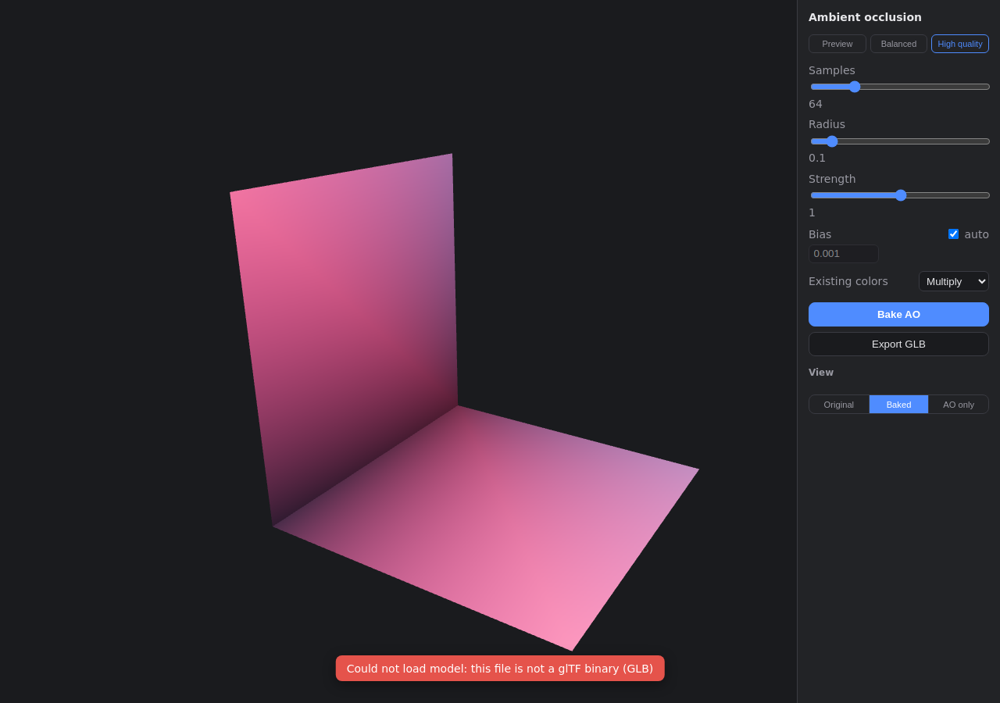

# ao-baker

Bake ambient occlusion into a GLB's vertex colors — entirely in your browser.
Drop a `.glb`, tweak the bake, preview the result on an orbitable model, and
export a new GLB with baked `COLOR_0`. No uploads, no backend, no install.



## Usage

1. Open the app and **drop a `.glb`** onto the page.
2. Adjust the bake parameters (or pick a preset) and click **Bake AO**.
3. Inspect the result with the **View** modes: `Original`, `Baked`, or
   `AO only` (unlit — the best way to judge the bake itself).
4. Click **Export GLB** to download `<your-file>-baked.glb`.

The camera orbits with the left mouse button, zooms with the wheel, and pans
with the right button. Baking runs in a background worker, so the viewport
stays responsive; **Cancel** stops a running bake.

## Parameters

| Parameter | What it does | Notes |
|---|---|---|
| Samples | Rays cast per vertex | Higher = smoother, slower (8–256) |
| Radius | How far occlusion reaches | Fraction of the model's bounding-box diagonal |
| Strength | Contrast of the result | 0 = flat white, 1 = linear, >1 darker |
| Bias | Ray start offset along the normal | `auto` by default; raise it if you see speckles |
| Existing colors | What to do with input `COLOR_0` | `Overwrite` (default) replaces it; `Multiply` composites baked AO onto the model's original colors |

Presets (`Preview`, `Balanced`, `High quality`) are just parameter snapshots —
apply one, then keep tweaking.

## What happens to your file

ao-baker edits the **original glTF document** in place: it only adds (or
replaces) the `COLOR_0` attribute. Materials, textures, animations, skins,
extensions, extras, and node hierarchy are carried through untouched — the
export is your file plus baked vertex colors. This is why export uses
[gltf-transform](https://gltf-transform.dev/) rather than re-serializing the
scene.

Compressed inputs are supported:

- **Meshopt** (`EXT_meshopt_compression`) stays compressed on export.
- **Draco** (`KHR_draco_mesh_compression`) is decoded for baking and exported
  **decompressed** (there is no in-browser Draco encoder), so the file gets
  larger but the baked values stay exact.

## Limitations

- Skinned meshes bake in their **rest/bind pose**; morph targets are ignored.
- `EXT_mesh_gpu_instancing` is baked as a single placement.
- The occlusion radius is relative to the scene size; a tiny object sitting
  next to a huge one may need manual radius tuning.
- Draco input becomes uncompressed on export (see above).

## Development

```sh
npm install
npm run dev        # dev server (serves under /ao-baker/)
npm run build      # typecheck + production build to dist/
npm run preview    # serve the production build
npm run lint
npm run typecheck
npm test           # vitest
```

Architecture and design decisions live in [`docs/architecture.md`](docs/architecture.md)
and the roadmap in [`docs/roadmap.md`](docs/roadmap.md). This repo is
spec-driven with OpenSpec — see `openspec/`.

## Deployment

GitHub Pages via GitHub Actions on push to `main` (`.github/workflows/deploy.yml`).
The site is served from the `/ao-baker/` base path; Vite `base` is set
accordingly. The Pages source must be set to "GitHub Actions" once in the
repository settings.
